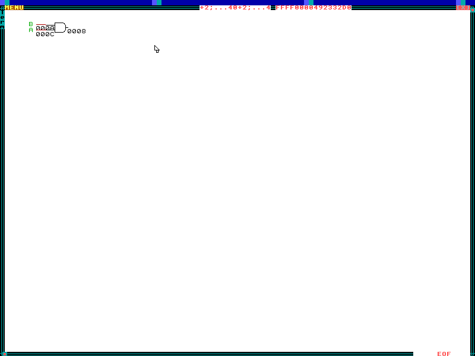
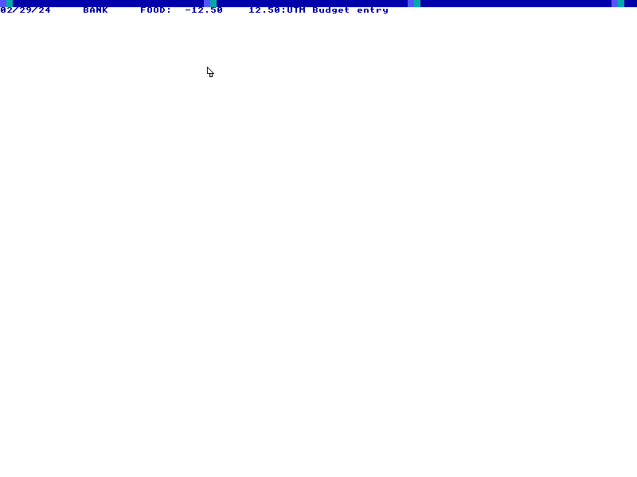

# Regular ZealOS programs on ARM64

The desktop, compiler and installer milestones do not establish that every
regular ZealOS application works. Programs are imported from the same public
ZealOS commit as the system sources:
`eee210f4379ba3d00b47507f336a158eefb2c993`. Exact file hashes are recorded in
`upstream/pinned/UPSTREAM.json` and verified by `make check-upstream`.

## Unchanged graphics programs

The source bundle now contains these original files, with no program edits:

| Program | Launch from a graphical terminal | Exit |
|--|--|--|
| Net of Dots | `#include "/Demo/Graphics/NetOfDots"` or Apps → Net of Dots | Press a character key at PRESS A KEY |
| Lines | `#include "/Demo/Graphics/Lines"` or Apps → Lines | Press a character key or Escape |
| Doodle | Apps → Doodle | Escape |
| Mass Spring | Apps → Mass Spring | Return resets; Escape exits |
| Game of Life | Apps → Game of Life | Escape |
| Digital Logic | Apps → Digital Logic | Press a character or Escape after the circuit is drawn |

`make check-stock-programs` runs both through the graphical terminal with
UTM's NEC USB controller model. It checks actual menu selection, visible
drawing/animation, removal of previous document text, key exit, a working
prompt afterward and signed integer intrinsic boundary cases. The alternate
VirtIO input path is checked with:

```sh
python3 scripts/check-compat.py --pci --probe-stock-programs
```

`make check-stock-interactive` exercises Doodle's original color picker and
retained thick stroke, Mass Spring's mouse placement, spring creation, moving
masses and reset, and Life's drawing and background evolution. It also checks
that Escape restores a working terminal and that one actual pointer click
delivers exactly one down and one up. These three Apps entries select a light
task surface so the original black ink remains visible. Their upstream source
files are unchanged. The same checks can use VirtIO input with:

```sh
python3 scripts/check-compat.py --pci --probe-stock-interactive
```

The fan must remain visible in its own window across compositor redraws and
clear on exit. Lines must produce changing colored pixels inside that same
window. Red text in another terminal, menu changes and cursor blinking do not
satisfy those checks. The runtime keeps the upstream foreground (`gr.dc`)
separate from the compositor target (`gr.dc2`) so immediate-mode program
drawing can persist while the desktop refreshes.

The old `netdots`/`lines` bring-up commands use separately adapted legacy
sources. They are not the unchanged programs above. This gate covers drawing,
input and normal exit, not pixel-for-pixel graphics parity or arbitrary
application compatibility. Doodle, Mass Spring and Life also pass live UTM
drawing/input, simulation, reset where applicable, and Escape-to-terminal
checks on ISO `3b59782c…`. Physical Pi acceptance remains separate.

`/Demo/Games/RainDrops.ZC` is now runtime-accepted in the QEMU ARM64 graphical
terminal. Its guarded ARM64 bundle overlay paints the canvas white, matching
the original demo's empty-space color; the probe confirms the red geometry,
moving blue drops, Escape cleanup and terminal recovery. See
[`demo-raindrops-qemu-2026-11-02.json`](docs/acceptance/demo-raindrops-qemu-2026-11-02.json).

`/Demo/Games/Digits.ZC` also passes a QEMU ARM64 interaction probe: instructions,
the first pattern, guess input, invalid-answer score/retry, Escape and terminal
recovery. See [`demo-digits-qemu-2026-11-02.json`](docs/acceptance/demo-digits-qemu-2026-11-02.json).

`/Demo/Games/ElephantWalk.ZC` now passes a QEMU ARM64 graphical probe. The
guarded bundle overlay supplies the framebuffer drawing context and explicit
symmetry context; the probe verifies the grayscale sprite, Right-key redraw,
Escape cleanup and terminal recovery. See
[`demo-elephant-walk-qemu-2026-11-02.json`](docs/acceptance/demo-elephant-walk-qemu-2026-11-02.json).

`/Demo/Games/FlapBat.ZC` now passes a QEMU ARM64 runtime probe for its game
canvas, animation, Space flap, Escape cleanup and terminal recovery. The
scripted gameplay path did not trigger a collision sound, so FlapBat's collision
effect remains unverified. A 2026-11-09 QEMU VirtIO-sound follow-up captured
nonzero audio during gameplay and verified that the song task and tone stop
after Escape; it does not establish musical fidelity or live UTM/Pi behavior.
See [`flapbat-audio-qemu-2026-11-09.json`](docs/acceptance/flapbat-audio-qemu-2026-11-09.json).
The VirtIO driver and stock `Sound()`/`Beep()` paths are tested separately; see the sound records below and
[`demo-flapbat-qemu-2026-11-02.json`](docs/acceptance/demo-flapbat-qemu-2026-11-02.json).

`/Demo/Graphics/32BitPaint.ZC` now passes a QEMU ARM64 interaction probe for
its color HUD, mouse drawing, End clear, Shift+Escape cleanup and terminal
recovery. See [`demo-32bit-paint-qemu-2026-11-02.json`](docs/acceptance/demo-32bit-paint-qemu-2026-11-02.json).

`/Demo/Graphics/Symmetry.ZC` now passes a focused PCI QEMU runtime check. The
bootstrap launches its blocking `MessageGet` loop in a separate focused task;
the probe confirms pointer strokes appear on both sides of the symmetry axis,
Escape returns to the graphical terminal, and `zstatus` reports no failed
tasks. This is QEMU evidence; live UTM and Pi behavior remain unverified. See
[`demo-symmetry-qemu-2026-11-05.json`](docs/acceptance/demo-symmetry-qemu-2026-11-05.json).

`/Demo/Graphics/Pick.ZC` now passes a focused PCI QEMU interaction check. The
probe verifies its white canvas and sprites, a pointer drag that changes pixels
in the selected sprite region, Escape recovery to a terminal where `40+2;`
returns 42, and no failed tasks. Live UTM and Pi behavior remain unverified.
See [`demo-pick-qemu-2026-11-05.json`](docs/acceptance/demo-pick-qemu-2026-11-05.json).

`/Demo/Graphics/CommonAncestor.ZC` now passes a focused PCI QEMU check. The
probe confirms the generated colored tree renders, a key exits its `PressAKey`
wait, and the terminal accepts `40+2;` with no failed tasks. Live UTM and Pi
behavior remain unverified. See
[`demo-common-ancestor-qemu-2026-11-05.json`](docs/acceptance/demo-common-ancestor-qemu-2026-11-05.json).

`/Demo/Lectures/MiniGrLib.ZC` now passes PCI QEMU scanout and recovery: its
generated framebuffer image changed 42,483 scanout pixels, then the graphical
terminal returned and evaluated `40+2;` as 42. Live UTM and Pi behavior remain
unverified. See
[`demo-mini-grlib-qemu-2026-11-07.json`](docs/acceptance/demo-mini-grlib-qemu-2026-11-07.json).

`/Demo/Disk/DataBase.ZC` now passes a focused PCI QEMU form and storage round
trip: it saves account 0, reopens the original source, reads both fields from
disk using the shared ARM64 `ClassRep` bridge, and returns to a working
terminal. A QEMU check also reopened both fields after a cold boot from the
same virtual disk. The bridge adapts the compiler metadata layout and treats
some unresolved function-pointer metadata conservatively; complete reflection
parity, live UTM and Pi behavior remain unverified. See
[`demo-database-qemu-2026-11-07.json`](docs/acceptance/demo-database-qemu-2026-11-07.json).

The ARM64 compiler now emits matching 32-bit exclusive loads and stores for
locked updates, and zero-extends unsigned 16- and 32-bit operands. A
UTM-framework QEMU probe reproduced the previous 32-bit carry and unsigned
16-bit failures, then passed the corrected pointer checks and an existing
64-bit check. A follow-up fixed the separate locked prefix/postfix update
path and passed combined 16-, 32-, and 64-bit pointer checks. The exclusive
store now uses distinct status and data registers, retries from the stable
address, and its load has the acquire encoding; generated instructions are
checked in the same regression. See [the lock-width record](docs/acceptance/lock-width-utm-qemu-2026-11-09.json).
The parser now marks the current locked statement rather than preceding
instruction-list nodes. A nested function-call argument and neighboring
braced/unbraced lock statements pass generated-code and functional checks;
expression results are published after the exclusive store. A later test found
global locked updates lacked exclusive instructions; address normalization
now covers tested globals and address-exposed stack locals as well as pointers.
This single-vCPU test does not establish SMP contention behavior.

## Digital Logic and embedded resources

`make check-logic-program` runs the original `/Apps/Logic/Run.ZC` from the Apps
menu with NEC USB input. The same test also passes with VirtIO input:

```sh
python3 scripts/check-compat.py --pci --probe-logic-program
```

The gate compares all ten original gate bitmaps against their saved pixels,
checks the original AND solver, then types through the actual application
prompts and checks the visible circuit, Escape, window restoration and a
subsequent `6*7;` answer. It then reopens Logic, solves an OR circuit and checks
that the gate changes and exits cleanly again. It also verifies visible
Backspace/forward Delete and middle-of-line edits, malformed numeric input
recovery, all three missing-value aborts and Shift+Escape. Each exit must
restore terminal geometry, remove the drawing callback and accept `40+2;`.
Live UTM confirmed the AND
circuit, but the initial `804f42c2…` image failed prompt-editing/abort checks:
Backspace left stale text and an early abort reached an unimplemented
`PutExcept`. On 2026-10-26 the user confirmed the requested corrected-image
retest works. The new screenshot confirms the expected AND circuit; prompt
editing, setup cancellation and terminal recovery are accepted by user report.
See [the live acceptance record](docs/acceptance/utm-logic-prompt-fix-2026-10-26.json).
The accepted program-test ISO is `build/zealos-aarch64-logic-prompt-fix.iso`
(`9c5e90c9…`), also promoted to `build/zealos-aarch64-hello.iso`. It can run the
program directly from its USB CD without installation.
For the small live example, enter `AND`, Return, then another Return to finish
the gate list. Enter `0x10` for table size; inputs `0xC`, `0xA`, then an empty
line; output `0x8`, then an empty line. The result is a two-input AND gate.
During setup, Shift+Escape returns an empty value. At the table-size prompt
this aborts setup; at an input/output prompt an empty value finishes that list.
Plain Escape exits the circuit view, but does not cancel a setup prompt in the
original document reader.



Nested source includes now use the same DolDoc reader as `ExeDoc`. They retain
embedded binary constants after an include reaches EOF and close owned
documents on normal completion and compiler recovery. The common document
loader recovers the UTF-8 representation of CP437 binary tails found in 54
pinned Apps/Demo documents; it preserves native packed files and source text.
The bitmap writer, size reader and renderer use the original packed 17-byte
bitmap header and preserve transparent pixels. This does not establish support
for every other serialized sprite opcode.

`make check-doc-bytes` checks exact resource decoding and malformed inputs.
`make check-doc-includes` checks saved binary documents, relative nested
includes, file/line provenance, constant lifetime, catchable malformed data and
repeated failed compilations without managed-memory growth. Application source
should use the graphical terminal's normal `#include`/`ExeFile2` path; the
bootstrap `zload` command does not itself decode a DolDoc root file.

## Budget candidate

Budget now has the calendar, clock, string scanning and class-form services
needed by its original entry/data code. Apps → Budget opens its default
`~/Budget` accounts. Click a field to edit it; Escape accepts a form and
Shift+Escape cancels it. In the main Budget view, Escape saves and exits;
Shift+Escape exits without saving changes. The clock defaults to UTC.

`make check-budget-program` checks calendar boundaries and formatting, the
boot wall clock, class metadata and inferred class names, scanner cleanup,
and malformed-source recovery. Its visible workflow creates an entry, edits
and aborts a change, cancels a new form, saves, reopens and checks the data
after a cold disk-only reboot. The NEC USB gate passes 115 checks on
`build/zealos-aarch64-budget.iso` (`00b5cd34…`). The exact ISO also passes
USB-CD installation, full read-back and two disk-only persistence boots.
Live UTM then exposed a menu-hover freeze in that image. The replacement is
`build/zealos-aarch64-budget-menu-fix.iso` (`c92f5f3c…`), which loads missing
key-name services and parses the original File/Edit/View shortcuts.
Its expanded NEC USB gate passes 140 checks, including actual shortcut hover,
menu selection and cold disk-only entry persistence. See
[the correction report](docs/acceptance/utm-budget-menu-fix-2026-10-27.json).
The current combined Logic/Budget/3D image is at
`build/zealos-aarch64-hello.iso`; its shared `DocForm` correction is described
below. Live UTM acceptance of the corrected Budget workflow is still pending.
A later integrated-candidate check covers daily and monthly template expansion,
purge and periodic copies at the data level, including a year boundary; see
[the Budget template check](docs/acceptance/budget-integrated-template-qemu-2026-11-09.json).
A direct data-routine check also writes, reopens and expands a monthly template
after a cold guest reboot; an empty-disk negative control fails as expected.
A separate NEC USB test creates an interval template through Budget’s forms,
saves it and reopens it after a cold boot. Template modification/deletion is
covered below; account-file editing and account-filter UI remain unverified,
and live UTM acceptance remains open.
The follow-up [template edit/delete acceptance](docs/acceptance/budget-integrated-template-qemu-2026-11-09.json)
now covers changing the end date, amount and description, saving and reopening
the edited template, deleting it with Ctrl-Y, and verifying that deletion
survives a cold disk-only reboot. Account-file editing, account-filter UI and
the older reported live UTM freeze still need separate checks.

Budget records dated transfers between accounts and displays a balance.
An empty white ledger is expected before the first transaction. Choose
Edit → New Entry or press lowercase `n` to open the Date/Amount/accounts/Desc
form. A small example is amount `12.50`, credit `BANK`, debit `FOOD` and a
description; the default date `*` means the current date. Escape accepts the
form, or Shift+Escape cancels it. File → Exit saves and returns to the terminal;
File → Abort returns without saving changes.

The pinned Budget files remain byte-identical to upstream. The generated
`BgtStrs.ZC` corrects one separator comparison from a two-byte comma/space
literal to a comma, so account names do not gain a comma when reopened.
The factory image seeds the original `Accts.DD` in `Home/Budget`; this does
not implement the general directory creation or copy APIs used by upstream's
installer. Saving requires a writable installed VirtIO source volume.



## Current named-app status — 2026-11-02

A separate [installer candidate](docs/acceptance/candidate-installer-utm-qemu-2026-11-09.json) includes the current document and popup fixes. It passed an automated USB-CD install, full disk read-back and disk-only persistence, plus the 3D gate using UTM's QEMU framework and `virtio-ramfb`. The Pi desktop kernel builds, but this candidate has not been tested in the live UTM UI or on the Pi.

The matching [Pi desktop payload](docs/acceptance/pi-desktop-candidate-2026-11-09.json) is prepared separately and passed its boot-chain validator and host platform tests. It has not been written to microSD or tested on physical hardware.

The follow-up [ToTheFront-fix candidate](docs/acceptance/tothefront-installer-utm-qemu-2026-11-09.json) includes the player-2 visibility correction in both its live bundle and installed disk. Its USB-CD installer, disk-only persistence and uninstrumented ToTheFront artillery workflow pass using UTM's QEMU engine. A matching Pi payload has been prepared, but neither candidate has been checked in live UTM UI or on physical Pi hardware.

The pinned upstream `src/Apps` and `src/Demo` mirror contains 294 files,
including source, documents and binary resources. It is complete and
hash-checked; that file count is not a count of supported programs. This
table tracks the named Apps currently in scope alongside Logic. A compile or
normal-load result is not runtime acceptance.

| Application | Current verified status |
|--|--|
| Budget | Graphical entry form, field editing, save/abort, reopen and cold disk-only persistence pass in the latest [PCI QEMU workflow](docs/acceptance/budget-hash-followup-qemu-2026-11-09.json), including a [current-build NEC USB input run](docs/acceptance/budget-current-nec-usb-qemu-2026-11-09.json). The same workflow passes with UTM's bundled QEMU profile ([UTM QEMU check](docs/acceptance/budget-utm-qemu-2026-11-09.json)); this is not a visible UTM app-window retest, so the earlier live freeze report remains open. Interval templates can be created, edited, deleted, and verified across cold disk-only boots in the [NEC USB template UI run](docs/acceptance/budget-integrated-template-qemu-2026-11-09.json). Account-file editing and account-filter UI remain open. |
| GrModels | The current candidate fixes a partial-document output regression that rendered the Man and Ball button directives as text. With UTM's QEMU engine and `virtio-ramfb`, Man and Ball reach mesh generation and Ball renders visibly inline. The full gate passes after correcting an early return from synchronous popups; live UTM and Pi retests remain open. See [the display and regression record](docs/acceptance/partial-dollars-utm-ramfb-2026-11-09.json) and [RAM comparison](docs/acceptance/utm-ram-headroom-qemu-2026-11-02.json). At `Do another(y or n)?`, enter `n` to finish the current model and return. |
| KeepAway | PCI gameplay frame renders; Space and mouse input leave the court active, Escape returns to the terminal, and the `40+2;` smoke check passes. The 2026-11-02 183-second run on ISO `e34393b6…` kept scanout active through game-over and Escape recovery. A fresh 1 GiB rerun on ISO `321232fb…` also passed gameplay and terminal recovery; see [the current 3D acceptance record](docs/acceptance/three-d-apps-qemu-2026-11-02.json) and [RAM comparison](docs/acceptance/utm-ram-headroom-qemu-2026-11-02.json). A 2026-11-09 headless run with UTM's bundled QEMU and `virtio-ramfb` kept scanout changing for 185 seconds and passed Escape recovery, narrowing but not resolving the earlier live UTM freeze ([UTM QEMU check](docs/acceptance/three-d-apps-utm-qemu-2026-11-09.json)). The source overlay guards nearest-player selection. ARM64 `Beep()` emits a VirtIO tone and `SoundReset()` stops it. The pinned `Noise()` and `Sweep()` tasks now produce PCM in isolated QEMU captures, but effect timing and the earlier live UTM freeze need further verification; see [sound effects](docs/acceptance/sound-effects-qemu-2026-11-09.json). A later full-game QEMU run captured nonzero audio bracketed around KeepAway gameplay and passed Escape recovery; individual effects and live UTM/Pi sound remain unverified ([audio check](docs/acceptance/keepaway-audio-qemu-2026-11-09.json)). |
| Psalmody | PCI graphical probe enters the editor, accepts a note, exercises playback, and returns with Shift+Escape to a working terminal. QEMU VirtIO sound note playback passes with WAV capture. The user also heard a note from the z, h, x sequence through Pi 4B HDMI; see [the live report](docs/acceptance/pi4-ohgreat-hdmi-live-2026-11-09.json). Sustained playback, other features and live UTM app audio remain unverified. |
| Oh Great (Demo) | The user confirmed the song plays through Pi 4B HDMI and stops after a delay when a key is pressed. A UTM-QEMU run of the newer ToTheFront-fix disk captured 49 seconds of PCM, reached a late lyric, stopped after a key and executed a command in the terminal task. The Pi image hash was not independently verified, and the UTM-QEMU capture is not a live audible UTM check; see [the sound record](docs/acceptance/pi4-ohgreat-hdmi-live-2026-11-09.json). |
| Span | QEMU graphical entry/help/frame, bridge editing, Shift+Escape worker cleanup, and return to a working terminal pass; `40+2;` returns 42. An edited mass survives Save As, New, Open and a cold disk-only reboot; see [the save/reopen check](docs/acceptance/span-save-reopen-qemu-2026-11-09.json). Entry, bridge view and Shift+Escape recovery also pass with UTM's bundled QEMU profile ([Span/Strut check](docs/acceptance/span-strut-utm-qemu-2026-11-09.json)). Complete bridge behavior and live UTM/Pi interaction remain unverified. |
| Strut | QEMU help, two masses connected by a visible spring, Space play-mode switch, Escape recovery, and terminal `40+2;` -> 42 pass. A follow-up added a third mass and a digit-controlled thruster: holding the digit changed the ship area and star field while the preceding idle frames were identical. See [the spring and thruster checks](docs/acceptance/strut-spring-qemu-2026-11-09.json). Help, edit/play input, graphics and Escape recovery also pass with UTM's bundled QEMU profile ([Span/Strut check](docs/acceptance/span-strut-utm-qemu-2026-11-09.json)). This checks one simulated thrust path, not complete physics or live UTM/Pi interaction. The pinned app exposes no save or open command. |
| TimeClock | App compile, date/time formatter gates, and automated punch-in/out record write/read plus report-state round-trip pass. The graphical QEMU probe loads the stock app, submits both descriptions through `StrGet`, reads them back with `TimeRep;`, and recovers to a terminal where `40+2;` returns 42. This workflow also passes with UTM's bundled QEMU profile ([UTM QEMU check](docs/acceptance/timeclock-utm-qemu-2026-11-09.json)). The red `IN`/`OUT` report labels are below the probe's monochrome OCR threshold, so it asserts the saved descriptions instead. Verify clock behavior in live UTM; CMOS hardware clock access is unavailable. |
| Titanium | Live UTM confirms gameplay, Space firing and Escape recovery; the user confirms ordinary Left/Right move the ship on ISO `219d751c…`. A fresh 1 GiB PCI rerun on ISO `321232fb…` passes gameplay and terminal recovery. The VirtIO keyboard bridge updates both merged and raw scan-code bitmaps. A later gameplay run captured PCM at pitches consistent with Titanium effects in QEMU; exact effect timing and live UTM/Pi audio remain unverified. See [the audio check](docs/acceptance/titanium-audio-qemu-2026-11-09.json). |
| Chess (Demo) | PCI QEMU runtime probes using VirtIO and emulated USB mouse input render the board, move a pawn by dragging, and verify a computer reply with its move notation. Escape returns to a terminal where `40+2;` returns 42. The same human move/computer reply and recovery pass with UTM's bundled QEMU profile ([current UTM QEMU check](docs/acceptance/chess-utm-qemu-2026-11-09.json)). Other moves, complete games, and visible UTM/Pi interaction remain unverified. The ARM64 `MouseSet` bridge posts a guest mouse-move message; it does not warp the host pointer. See [the pawn-move check](docs/acceptance/demo-chess-pawn-qemu-2026-11-09.json) and [computer-reply check](docs/acceptance/demo-chess-ai-qemu-2026-11-09.json). |
| TicTacToe (Demo) | The ARM64 adaptation passes a five-move win, board reset, replay, and Escape recovery in QEMU with VirtIO input. Ctrl-Alt-C recovery also passed with VirtIO and emulated USB input. A nine-move draw, board reset and replay pass with UTM's bundled QEMU profile ([draw check](docs/acceptance/tictactoe-draw-utm-qemu-2026-11-09.json)); the same scenario has now also passed against the current image ([current UTM QEMU run](docs/acceptance/tictactoe-utm-qemu-2026-11-09.json)). Other game outcomes and visible UTM/Pi interaction remain unverified. See [the cleanup check](docs/acceptance/tictactoe-break-cleanup-qemu-2026-11-09.json). |
| ToTheFront | ARM64 source overlays fix the Human player's indirect-fire unit-count loop and direct-fire visibility check. The latter previously rejected player 2's shot at a target visible only to that player. A controlled QEMU fixture reproduces that failure and passes mouse-driven direct fire for both players with the fix; it places adjacent targets for the test. A separate candidate check covers setup, artillery and a mouse-driven move. Setup, map, artillery order, Escape and shell recovery also pass with UTM's bundled QEMU profile ([UTM QEMU check](docs/acceptance/tothefront-utm-qemu-2026-11-09.json)). See [the checks](docs/acceptance/tothefront-candidate-qemu-2026-11-09.json). The follow-up ISO includes the fix; broader AI gameplay and live UTM/Pi behavior remain unverified. |
| Vocabulary | QEMU PCI runtime probe launches the quiz, displays dictionary content, accepts a numbered answer and advances, then Escape returns to a terminal where `40+2;` returns 42. This also passes with UTM's bundled QEMU profile ([UTM QEMU check](docs/acceptance/vocabulary-utm-qemu-2026-11-09.json)). Dictionary indexing and lookup are covered by the autocomplete gate. A sound-device run captured the 196 Hz incorrect-answer tone. The transient answer-feedback popup, live UTM and Pi sound remain unverified. Run `make check-vocabulary-program`. |

| X-Caliber | The newer 2026-11-08 PCI QEMU run on ISO `fd42cae1…` verified both plain arrows, a visible Space projectile, and Escape back to the graphical terminal. It later failed a shared terminal check after a stale `4` appeared in the prompt. A fresh run on disk `2d875c42…` passed both arrows, firing, and Escape again. The revised probe submitted `40+7;` with Return and verified a new result of 47. The shared terminal then accepted and executed `help`. See [the earlier run record](docs/acceptance/xcaliber-qemu-2026-11-08.json). |

A subsequent Vocabulary run using the graphical launcher captured a tone
consistent with its correct-answer `Sound(74)` as well; see the
[QEMU record](docs/acceptance/vocabulary-correct-sound-qemu-2026-11-09.json).

The 2026-11-08 task-message regression passes in PCI QEMU. Five rounds of empty
`MessageScan`, `KeyScan`, `CharScan`, and `FlushMessages` polling do not hand off
the core; explicit `Yield` and a blocked `MessageGet` let the next ready task
run. The earlier timer-sleep handshake was removed from this focused regression
because it could hang while draining session tasks. This verifies the current
cooperative bridge behavior, but does not mean the pinned upstream `Sched.ZC` is
the scheduler currently running. See
[`task-message-scheduling-qemu-2026-11-08.json`](docs/acceptance/task-message-scheduling-qemu-2026-11-08.json).
`BreakUnlock` now delivers an already-pending break to the current task or
queues it for another task's cooperative resumption. QEMU checks cover
sleeping and message-waiting tasks and the Shift-Escape option. A focused
task also caught a real Ctrl-Alt-C after its break lock was released; when
the chord arrived during MessageScan polling, handling waited for Yield. The
workflow also passed with emulated QEMU and NEC USB controllers, including
USB/VirtIO keyboard ownership changes.
The bridge clears interrupted wait state, wake time, popup wait flags and
queued messages on Break. Native drive and block-device lock release is not
implemented; see
[the pending-break record](docs/acceptance/task-break-pending-qemu-2026-11-09.json).
The terminal output bridge now uses the pinned `DocPrintPartial`, matching the
upstream output path's partial-document behavior and its conditional yield.
The first Ctrl-Alt-C check only verified serial recovery and missed that the
bootstrap shell stopped the graphical terminal. The keyboard byte queue now
retains the Alt modifier so that Ctrl-Alt-C reaches the guest without invoking
the shell's Ctrl-C escape. Three QEMU VirtIO DebugDemo runs then preserved the
graphical terminal and executed a new command in it after each break. A further
keyboard handoff fix also preserved the separate plain Ctrl-C shell escape;
both behaviors passed with QEMU VirtIO and emulated xHCI USB keyboards. The
`DOCF_DONT_SWAP_OUT` and message-polling scheduler checks also passed. Ctrl-Alt-D,
live UTM and Pi remain unverified. This is not the pinned `Sched.ZC` scheduler.
The unchanged output path also failed the no-growth check (+96 data bytes
across two cycles); a separate diagnostic run timed out during long input before
a second heap snapshot. The cause remains unconfirmed. See
[`terminal-output-investigation-2026-11-09.json`](docs/acceptance/terminal-output-investigation-2026-11-09.json).
An exploratory repeat with per-task heap totals found that the separate
AutoComplete task's live allocation size fluctuated while global heap use and
allocation count remained constant. The aggregate test therefore cannot by
itself attribute its variation to terminal teardown.
An independent check of three UserText terminal/filter cycles found no live
allocations owned by finished tasks. It does not cover shared allocations or
allocations retained by live tasks, so the aggregate no-growth failure remains
open.
An isolated live-task test found that interrupting partial document output
retained 16–32 bytes per run. A guarded ARM64 overlay now releases its scratch
buffer and acquired document lock when document processing throws, then
rethrows the same exception. Normal completion and three interrupted QEMU
runs retained zero bytes in that focused test. A callback that throws also
previously retained 16 bytes; the extended overlay now cleans that path, and
QEMU checks passed for callbacks that handle, decline or throw on output.

The 2026-11-01 rebuilt PCI QEMU catalog reconfirmed compilation of all 12 named
app entry points. A comprehensive PCI QEMU run of the named-app probes completed with
exit status 0 for Logic, Budget, TimeClock, GrModels, KeepAway, Titanium,
Span, Strut, ToTheFront, Vocabulary, and Psalmody. The X-Caliber focus and
Escape issue recorded during an earlier trace is superseded by the current
PCI QEMU probe: sequential Left/Right, Space firing, Escape, and terminal
recovery pass on ISO `e34393b6…`; see its dated acceptance record.
Runtime probes also passed for Digital Logic, ToTheFront, Span, Strut,
TimeClock, Vocabulary and Psalmody. The dependency-aware Demo catalog covers
all 206 upstream `.ZC` files in a fresh full PCI QEMU sweep. `/Demo/NullCase.ZC` was rechecked after
the implicit-case parser fix, and the ToHtmlToTXTDemo sources were rechecked after expanding the code arena and binding `Log10`. `HtmlGen.ZC` now compiles with normal file loading (preserving its relative include), and `TXTGen.ZC` compiles after loading the stock `ToTXT` module. The refreshed dependency-aware PCI QEMU source sweep compiles all 206 Demo sources; the five failures recorded in the earlier 2026-11-02 run were subsequently resolved by correcting stock-module context and ARM64 adaptations. This is source compilation evidence, not runtime acceptance. The refresh confirms the LightTable compile follow-up and adds AArch64 SVC adaptations for InterruptDemo and Ring3; runtime probes pass for both adaptations, while Ring3 explicitly reports that EL0 tasks remain unsupported. `/Demo/Asm/PutDec.ZC` now uses an ARM64-portable right-to-left decimal conversion; `/Demo/Asm/AsmHelloWorld.ZC` preserves the ten-line output with the portable printer, and `/Demo/Asm/BuzzFizz.ZC` translates the stock 1–100 loop with its original spans; `/Demo/Asm/MulByHand.ZC` provides a shift-and-add byte multiply plus a 32-bit-limb 64×64→128 multiply; `/Demo/Asm/DivByHand.ZC` supplies restoring 64-bit division; all five compile. Focused QEMU guest checks validated the arithmetic results and edge cases (see `docs/acceptance/demo-mulbyhand-math-2026-11-01.json` and `docs/acceptance/demo-divbyhand-math-2026-11-01.json`); full demo output acceptance remains separate. These are compile results, not runtime acceptance. The inventory now uses a source-preserving loader for `Directives.ZC`; native lexer built-ins for `__DATE__`, `__TIME__`, and `__CMD_LINE__` also let `WebLogRep.ZC` compile. `ClassMeta.ZC` now passes its graphical QEMU probe: the ARM64 reflection bridge displays the `age` and `serial_num` fields, the assigned `55555`, and returns to a working terminal. The overlay renders `RankOut` inline and represents percentile metadata using supported forms; this adapts this demo and does not establish general callback-pointer metadata compatibility. This closes the shared `sys_compile_time` external-data blocker in both HomeSys examples: the runtime now binds the build `CDate`, and isolated compile tasks resolve exported host data. The lexer preserves comment markers inside quoted `#define` strings, fixing the file-mask macro in `HomeWrappers.ZC`; loading the stock `System/Utils/Find.ZC` dependency lets that source compile. Expanding the lexer literal buffer allows the long literals in `MemDemo.ZC` and `WaterFowl.ZC` to compile. `SpriteText.ZC` now compiles with the isolated probe’s compiler and sprite module setup. `PhoneNumWords.ZC` also compiles after changing its A–Z digit lookup to a 26-element explicit initializer in the ARM64 overlay. FlatTops now compiles when the isolated probe loads the stock `GrDC`, `GrMath`, `GrPrimatives`, and `GrComposites` modules; TreeCheckers compiles with its required constants and stock Math/Sound modules. TOSTheme, InSetIP, UnusedSpaceRep, UnusedDefine, and SerializeTree now compile with their stock module dependencies loaded. The `SysRep.ZC` ARM64 overlay removes x86 CPUID-specific reporting; `AndNotMod.ZC` and `FixedPoint.ZC` now compile with the stock `SysRep` and `CPURep` modules. The upstream sources are unchanged. The refreshed catalog also compiles `/Demo/MultiCore/LoadTest.ZC` with the stock compiler headers and program modules loaded, correcting a probe-context false negative. Its QEMU runtime acceptance now exercises a cooperative CPU-0 worker loop, app key exit, and terminal recovery; the ARM64 bundle substitutes JIT loads of stock `Print.ZC` for the unavailable x86 `Compiler.ZXE` worker and maps stock CPU-1 worker requests to the bridge’s CPU 0. This does not establish SMP or AOT compiler support; see [`demo-loadtest-qemu-2026-11-09.json`](docs/acceptance/demo-loadtest-qemu-2026-11-09.json). The `Mandel.ZC` ARM64 overlay now uses ZealC-supported syntax for its one-CPU worker count; its rebuilt QEMU image rendered the fractal, handled Escape, and returned to a terminal where `40+2;` yielded 42. The same pass restored the stock `Blink(F64 Hz=2.5)` API in `TaskBridge.ZC`. CharAnimation, outside the Demo tree, also compiled with its required
stock modules. The Grid probe exposed two missing ARM64
bridge services, `GridInit` and `DCFill`; both are implemented in `TaskBridge.ZC`,
and an on-guest check validates them and returns `0x2a`. Grid and MouseDemo
also needed an overlay to pass `gr.dc` explicitly to `GrPlot`, because the
isolated source loader does not retain its default first argument; both now
compile in the broad sweep. These
are source-file results, not a count of runnable programs. The refreshed source catalog records all 206 Demo `.ZC` sources as compile passes and zero compile blockers. Ring3 now compiles and its AArch64 SVC adaptation runs, but it does not implement ring-3/EL0 tasks. TOSConfig itself now compiles after the ARM64 overlay disables the legacy x86 debug-distro RAM mapping; it is compile evidence only, not acceptance of the TOS installer workflow.
The source-by-source failures are listed in the generated ledger. The Carry
demo has an ARM64 source overlay that explicitly computes the carry bits
used by its two-word count, shift, and branch examples; its runtime behavior is
accepted as described below. Consecutive `#exe` blocks now execute in source
order, with a QEMU regression and GlobalVars recheck recorded in
[`exe-order-qemu-2026-11-09.json`](docs/acceptance/exe-order-qemu-2026-11-09.json).
`StreamPrint` now injects generated source, and the unmodified `DefineStr.ZC`
passes its focused QEMU document test; see the [acceptance record](docs/acceptance/stream-print-qemu-2026-11-09.json).
Simple statements inside `#exe` now execute individually in source order;
the [regression](docs/acceptance/exe-statement-order-qemu-2026-11-09.json)
checks a definition created by one statement and consumed by the next.
A directive following an `if` inside `#exe` executes while the parser looks
for `else`, before that `if` executes. This appears consistent with the
pinned ZealOS source; the opt-in QEMU regression returns 41. See
[`exe-directive-lookahead-qemu-2026-11-09.json`](docs/acceptance/exe-directive-lookahead-qemu-2026-11-09.json).
The previous fix that re-expands a name after an `if` executes needs an
upstream x86 comparison: pinned `ParseIf` also looks ahead at identifiers
before executing the `if`, so the current behavior may diverge from ZealOS.
Full `#exe` semantics remain unverified. A direct QEMU load of the original
`TimeIns.ZC` currently fails at `PassTrace`; the bundled ARM64 timing demo is
an adaptation and does not demonstrate the original optimizer-trace behavior.
See [`demo-time-ins-stock-qemu-2026-11-09.json`](docs/acceptance/demo-time-ins-stock-qemu-2026-11-09.json).
The graphical terminal now re-anchors its document cursor while clearing or
replacing a line, fixing a QEMU long-line display mismatch; see the
[input regression](docs/acceptance/gui-long-input-qemu-2026-11-09.json).
Physical Pi and live UTM validation remain outstanding.
The missing-block-device bridge now throws `Drive` when requested, matching
the upstream missing-drive contract. A separate read-only primitive can read
absolute PCI VirtIO disk sectors, with a [QEMU GPT and bounds check](docs/acceptance/raw-disk-read-qemu-2026-11-09.json).
The legacy RedSea window can now be identified only after checking its boot
header and bounded root; [QEMU fixtures](docs/acceptance/raw-redsea-geometry-qemu-2026-11-09.json)
cover stock absolute and bootstrap relative addresses, absent media, and a
malformed root.
An explicit experimental read-only `D` drive can now expose a validated
legacy volume to `Letter2Drive` and `BlkRead`; the original DiskRaw demo
completed a [QEMU read-only GPT-sector workflow](docs/acceptance/diskraw-readonly-qemu-2026-11-09.json).
Its bitmap geometry and `RedSeaValidate` behavior have a separate
[QEMU check](docs/acceptance/redsea-guest-drive-qemu-2026-11-09.json).
The `disk:` source provider can now read files from the
stock absolute-address layout; the [QEMU probe](docs/acceptance/stock-redsea-file-qemu-2026-11-09.json)
checks source loads from multiple root sectors and a nested directory, and
rejects invalid entries. As in upstream RedSea, file extents are read directly
even if the contiguous attribute is absent. This is not a general D: filesystem.
The same read-only source bridge can enumerate reachable stock RedSea files
and directories for `FilesFind`, including nested files and empty directories.
Direct directory checks and `Cd` can also resolve empty directories.
Empty stock RedSea files also read as zero-length files rather than missing
files. The native source store can create and reopen empty files; a QEMU check
overwrote a nonempty file with an empty file and reopened it after a cold boot.
This does not establish file operations, stock drive-registry integration,
writes, or a Pi storage backend. The boot source store remains separate.
`Directives.ZC` and `WebLogRep.ZC` now compile with native built-in handling. The previous ToHtml resource blocker is
resolved; the 96 MiB executable arena is reserved as zero-filled RAM so it
does not add 96 MiB to the ISO. The enlarged compiler arenas and recovery
copies reserve about 448 MiB of RAM; this QEMU build boots with 1 GiB, while
the expanded-memory configuration still needs physical Pi validation.
The ARM64 bridge provides waveform math helpers used by stock Sound sources;
the VirtIO sound driver initializes on QEMU; and the driver probe, ASCIIOrgan,
Psalmody and the `Beep()` probe produce stereo PCM through the WAV backend.
Normal and `busy=TRUE` Beep probes now both capture a full 500 ms, approximately
784 Hz tone in QEMU; the WAV contains 0.520 seconds including the queued audio
tail. The stock 200 ms trailing wait is implemented but has not been timed
independently. These checks establish QEMU playback-path behavior, not audible
output on UTM or Pi hardware.
See [`virtio-sound-qemu-2026-11-04.json`](docs/acceptance/virtio-sound-qemu-2026-11-04.json), [`demo-ascii-organ-sound-qemu-2026-11-04.json`](docs/acceptance/demo-ascii-organ-sound-qemu-2026-11-04.json), [`psalmody-virtio-sound-qemu-2026-11-04.json`](docs/acceptance/psalmody-virtio-sound-qemu-2026-11-04.json), and [`virtio-beep-qemu-2026-11-04.json`](docs/acceptance/virtio-beep-qemu-2026-11-04.json). The generated per-file
results are in `build/demo-source-catalog.json`; see the detailed run record
in [the program inventory](docs/PROGRAM-INVENTORY-2026-10-28.md). The
source-level ledger at
[`demo-source-ledger-2026-11-09.json`](docs/acceptance/demo-source-ledger-2026-11-09.json)
records the 206 Demo `.ZC` compile results. The refreshed ledger records 206 compile passes, zero compile blockers, 197 runtime-accepted sources, 8 partial runtime results, zero recorded runtime failures, and 1 source whose runtime remains unverified. The partial results are `/Demo/TimeIns.ZC`, `/Demo/DebugDemo.ZC`, `/Demo/AcctExample/TOS/TOSExtern.ZC`, `TOSMisc.ZC`, `/Demo/Graphics/WallPapers/WallPaperDesktop.ZC`, `/Demo/MultiCore/MPRadix.ZC`, `/Demo/MultiCore/Lock.ZC`, and `/Demo/Disk/DiskRaw.ZC`. `/Demo/DolDoc/UnusedDefine.ZC` completed its scan and returned to the terminal in an extended QEMU run; see [`demo-unused-define-qemu-2026-11-09.json`](docs/acceptance/demo-unused-define-qemu-2026-11-09.json). DiskRaw acceptance covers only its isolated read-only sector workflow; full UI and storage integration are not accepted. `/Demo/MultiCore/Lock.ZC` now passes the single-CPU worker path with matching expected and actual counts, terminal recovery, and no failed tasks; the CPU-1 requests map to CPU 0, so full Lock acceptance still requires SMP contention testing. See [`demo-lock-single-cpu-qemu-2026-11-09.json`](docs/acceptance/demo-lock-single-cpu-qemu-2026-11-09.json). Runtime evidence is still needed for `/Demo/AcctExample/TOS/TOSDistro.ZC`. The TimeIns ARM64 adaptation runs, but the stock source fails at `PassTrace` and optimizer tracing remains unsupported; see [`the stock-source probe`](docs/acceptance/demo-time-ins-stock-qemu-2026-11-09.json). The original `/Demo/DebugDemo.ZC` busy loop was interrupted three times by Ctrl-Alt-C in QEMU, with graphical terminal recovery after each; its debugger and live hardware checks remain open. See [`terminal-output-investigation-2026-11-09.json`](docs/acceptance/terminal-output-investigation-2026-11-09.json). These are source-level counts, not a count of standalone programs; several remaining files are support modules or have destructive/device-specific behavior that needs an isolated test setup. Runtime acceptance is also not proof of complete feature parity, and each evidence record states its scope and limitations. `/Demo/CompileDemo.ZC` now passes a focused QEMU run through the native guest compiler/JIT bridge, including multi-expression side effects, printed results, the final 0–9 loop, and terminal recovery; see [`demo-compiledemo-qemu-2026-11-02.json`](docs/acceptance/demo-compiledemo-qemu-2026-11-02.json). `/Demo/MultiCore/MPAdd.ZC` completes the stock serial-versus-queued benchmark, renders its performance chart, and returns to a working terminal in QEMU; see [`demo-mpadd-qemu-2026-11-07.json`](docs/acceptance/demo-mpadd-qemu-2026-11-07.json). `/Demo/MultiCore/MPPrint.ZC` visibly prints CPU0 queued-job output and returns to a working graphical terminal in one-vCPU QEMU; SMP worker execution remains unsupported and unverified. See [`demo-mpprint-qemu-2026-11-08-cpu0-color.json`](docs/acceptance/demo-mpprint-qemu-2026-11-08-cpu0-color.json). `/Demo/WordSearch.ZC` now renders its random grid and dictionary matches before returning to a working terminal; `/Demo/SuggestSpelling.ZC` returns dictionary matches for `Helo` and exits cleanly. `/Demo/LastClass.ZC` now displays CCPU and CTask class reports and returns to the terminal in QEMU after fixing task-to-compiler hash lookup; see [`demo-last-class-hash-fix-qemu-2026-11-08.json`](docs/acceptance/demo-last-class-hash-fix-qemu-2026-11-08.json). `/Demo/ParenWarn.ZC` displays source-file warnings and returns to the terminal in QEMU; see the later [`demo-paren-warn-qemu-2026-11-03.json`](docs/acceptance/demo-paren-warn-qemu-2026-11-03.json). Neither record establishes live UTM or Pi behavior. The 2026-11-02 QEMU probes add BlackDiamond, ScreenCapture, MathAudioDemo, PredatorPrey, ElephantWalk, FlapBat and 32BitPaint. BlackDiamond loads stock Math for `Cosh`, paints its light canvas, and verifies the HUD, movement, Escape cleanup, and terminal recovery. ScreenCapture writes a GR capture, reads it back into visible scanout, and returns to the graphical terminal. MathAudioDemo verifies its stock waveform plotting path, not audio output. PredatorPrey verifies queued trajectory rendering and Escape recovery. ElephantWalk verifies sprite rendering and keyboard-driven redraw. FlapBat verifies its game canvas, animation and Space input; a later QEMU sound-device run captured multiple pitches and confirmed the song task and tone stopped after exit (see `docs/acceptance/demo-flapbat-sound-qemu-2026-11-09.json`). 32BitPaint verifies mouse drawing, clear and exit. Directory-derived categories remain
provisional, and per-file runnable-versus-module classification is in progress.

`/Demo/MemDemo.ZC` and `/Demo/Carry.ZC` now have QEMU runtime acceptance.
MemDemo reaches the final system powers-of-two row. Carry reaches the `0x10`
high word in its two-word counter, shifts through the 64-bit boundary, and
prints all 64 branch bits from `0xFFCC3311` (the terminal wraps the result).
Both return to the prompt; `40+2;` returns 42 and `zstatus failed=0`. The
explicit Demo runtime acceptance count at that run was 45 sources. See the
[`demo-runtime-basics` record](docs/acceptance/demo-runtime-basics-2026-11-01.json)
and [Carry record](docs/acceptance/demo-carry-qemu-2026-11-02.json).

The portable assembly demos now have isolated PCI QEMU runtime acceptance.
AsmHelloWorld prints all ten numbered lines; BuzzFizz matches the FIZZ/BUZZ
spans for its visible output; PutDec prints `122333221` on its own line.
MulByHand prints its byte-multiply and 64-by-64-to-128-bit examples, and
DivByHand prints `123456/10=12345`. AsmAndC3 exercises inline assembly carry
handling and prints its three `0x42` results. All six return to the graphical terminal,
where `40+2;` returns 42 and `zstatus failed=0`. Explicit Demo runtime
acceptance is now 51 sources; see the [assembly output record](docs/acceptance/demo-asm-output-qemu-2026-11-02.json),
[arithmetic output record](docs/acceptance/demo-asm-arithmetic-qemu-2026-11-02.json),
and [AsmAndC3 record](docs/acceptance/demo-asmandc3-qemu-2026-11-02.json).
The interactive `/Demo/Define.ZC` also passes its Spanish prompt/localization
flow and returns cleanly; see the [Define record](docs/acceptance/demo-define-qemu-2026-11-02.json).
Explicit Demo runtime acceptance is now 52 sources.

A fresh run on the current ISO (`e34393b6…`) rechecked 13 graphical Demo
programs in PCI QEMU: Box, Hanoi, CircleTrace, Pick3D, 32BitColor, Blot,
MouseDemo, Grid, Palette, Bounce, Clock, 3DPoly, and RotateTank. Each reached
its drawing or interaction check, exited through its supported key path, and
returned to a terminal where `40+2;` produced 42. This refreshes evidence for
programs already included in the 32-source runtime tally. A separate focused
gate now verifies Slider's visible custom control, left-track click changing
the value to 9 while the right remains 0, and terminal recovery. This brings
the explicit Demo runtime acceptance count to 33 distinct sources. See the
[`Slider acceptance record`](docs/acceptance/demo-slider-qemu-2026-11-02.json) and
[`demo-graphics-qemu-2026-11-02.json`](docs/acceptance/demo-graphics-qemu-2026-11-02.json).

The system-context probe now accepts ordered `--demo-system-module` options to
load stock `/System/*.ZC` modules before compiling selected demos. The ARM64 overlay now lets the LightTable source compile in the isolated
module-aware probe. Its runtime behavior remains unverified; compile success does
not establish that the graphical demo works. The six baseline system-context demos still
compile in the fresh module-aware run.

An earlier sweep found 29 first compile failures. The later dependency-aware
source sweep resolved those catalog failures, as described above; compilation
alone does not verify original architecture-specific behavior or runtime parity.

The graphical QEMU probe `python3 scripts/check-compat.py --pci --probe-demo-basics`
runs the original Print, DateTime, RadixSort, SubIntAccess, SubSwitch and
NullCase demos through the visible terminal. It checks Print's number format
output, DateTime's clock/day/month fields, both 16-row RadixSort tables and
that the output equals the sorted input, the four SubIntAccess expressions,
all six SubSwitch branches and all six NullCase labels. It then verifies
terminal recovery with `40+2;` -> 42. This closes runtime coverage for those
six demos in PCI QEMU only; it does not
classify or accept all 206 Demo source files. The 2026-10-31 system-launch
gate also passes its `Log10` numeric checks. See
[`demo-runtime-basics-2026-10-31.json`](docs/acceptance/demo-runtime-basics-2026-10-31.json).

The current isolated catalog is `docs/acceptance/program-catalog-2026-10-27.json`;
its mode is `CCF_JUST_LOAD` plus selected normal-load checks. The sprite service fixtures
are `build/3d-apps-compile.json`. Neither report proves interactive app
behavior. The user confirmed live UTM drawing/simulation and Escape recovery
for Doodle, Mass Spring and Game of Life, and confirmed the Digital Logic
prompt fix. Their acceptance records are above. Chess and Varoom have focused
QEMU runtime checks, but those checks do not establish all their features or
live UTM/Pi behavior. Other sources also need broader acceptance. Assembly
demos require architecture-specific implementations.

The apparent Budget and GrModels form failures were traced to the generated
ARM64 `DocForm` adapter: its replacement left behind the original
`return FALSE`, causing every form to exit before document creation. The
translator now replaces the condition and its return as one block, with a
regression assertion on the generated source. The corrected PCI workflow
passes Budget form creation/edit/cancel/save/reopen and cold disk-only
persistence; the 3D live probe passes GrModels Man and Ball form and mesh
generation. KeepAway now runs through gameplay and returns cleanly in the PCI
probe. Track upstream source integrity separately from compilation, visible
behavior/input, clean exit and save/reopen requirements.

## Full Apps and Demo inventory / work plan — 2026-10-28

See [the file-derived inventory and phased plan](docs/PROGRAM-INVENTORY-2026-10-28.md).
The pinned mirror contains 70 `.ZC` files under `Apps` and 206 under `Demo`.
These are source-file counts, not runnable-program counts: both trees include
loaders, shared routines, templates, and data-driven examples. The inventory
keeps file presence, compilation, runtime, interactive behavior, and live UTM
acceptance as separate states.

The focused `/Demo/GlobalVars.ZC` probe passes its JIT half: the global and
static arrays print `Time 1` and `Time 2`, and the graphical terminal recovers
to evaluate `40+2` as 42. Its AOT-only `#ifjit` half remains unverified because
the current bootstrap does not expose the stock `Comp()` command. This is
partial runtime evidence and does not increase the fully accepted Demo count.
See [`demo-global-vars-jit-2026-11-01.json`](docs/acceptance/demo-global-vars-jit-2026-11-01.json).

`/Demo/Exceptions.ZC` now passes its nested Point1 throw/catch path in PCI QEMU.
The ARM64 formatter supports ZealOS `%P` pointer links, the demo reaches
`Caught in D2`, completes its final prompt, and returns to a terminal where
`40+2;` evaluates to 42. The Demo runtime ledger now records twelve fully
accepted programs; other exception paths and `%P` call sites remain unverified.
See [`demo-exceptions-2026-11-01.json`](docs/acceptance/demo-exceptions-2026-11-01.json).
