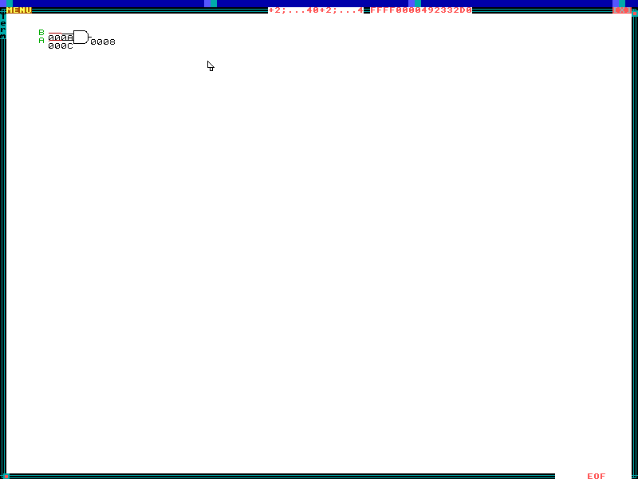
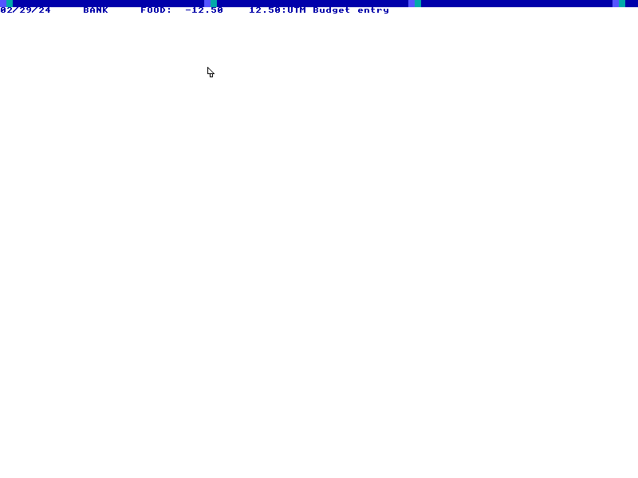

# Regular ZealOS programs on ARM64

The desktop, compiler and installer milestones do not establish that every
regular ZealOS application works. Programs are imported from the same public
ZealOS commit as the system sources:
`eee210f4379ba3d00b47507f336a158eefb2c993`. Exact file hashes are recorded in
`upstream/pinned/UPSTREAM.json` and verified by `make check-upstream`.

## Unchanged graphics programs

The source bundle now contains these original files, with no program edits:

| Program | Launch from a graphical terminal | Exit |
|--|--|--|
| Net of Dots | `#include "/Demo/Graphics/NetOfDots"` or Apps → Net of Dots | Press a character key at PRESS A KEY |
| Lines | `#include "/Demo/Graphics/Lines"` or Apps → Lines | Press a character key or Escape |
| Doodle | Apps → Doodle | Escape |
| Mass Spring | Apps → Mass Spring | Return resets; Escape exits |
| Game of Life | Apps → Game of Life | Escape |
| Digital Logic | Apps → Digital Logic | Press a character or Escape after the circuit is drawn |

`make check-stock-programs` runs both through the graphical terminal with
UTM's NEC USB controller model. It checks actual menu selection, visible
drawing/animation, removal of previous document text, key exit, a working
prompt afterward and signed integer intrinsic boundary cases. The alternate
VirtIO input path is checked with:

```sh
python3 scripts/check-compat.py --pci --probe-stock-programs
```

`make check-stock-interactive` exercises Doodle's original color picker and
retained thick stroke, Mass Spring's mouse placement, spring creation, moving
masses and reset, and Life's drawing and background evolution. It also checks
that Escape restores a working terminal and that one actual pointer click
delivers exactly one down and one up. These three Apps entries select a light
task surface so the original black ink remains visible. Their upstream source
files are unchanged. The same checks can use VirtIO input with:

```sh
python3 scripts/check-compat.py --pci --probe-stock-interactive
```

The fan must remain visible in its own window across compositor redraws and
clear on exit. Lines must produce changing colored pixels inside that same
window. Red text in another terminal, menu changes and cursor blinking do not
satisfy those checks. The runtime keeps the upstream foreground (`gr.dc`)
separate from the compositor target (`gr.dc2`) so immediate-mode program
drawing can persist while the desktop refreshes.

The old `netdots`/`lines` bring-up commands use separately adapted legacy
sources. They are not the unchanged programs above. This gate covers drawing,
input and normal exit, not pixel-for-pixel graphics parity or arbitrary
application compatibility. Doodle, Mass Spring and Life also pass live UTM
drawing/input, simulation, reset where applicable, and Escape-to-terminal
checks on ISO `3b59782c…`. Physical Pi acceptance remains separate.

## Digital Logic and embedded resources

`make check-logic-program` runs the original `/Apps/Logic/Run.ZC` from the Apps
menu with NEC USB input. The same test also passes with VirtIO input:

```sh
python3 scripts/check-compat.py --pci --probe-logic-program
```

The gate compares all ten original gate bitmaps against their saved pixels,
checks the original AND solver, then types through the actual application
prompts and checks the visible circuit, Escape, window restoration and a
subsequent `6*7;` answer. It then reopens Logic, solves an OR circuit and checks
that the gate changes and exits cleanly again. It also verifies visible
Backspace/forward Delete and middle-of-line edits, malformed numeric input
recovery, all three missing-value aborts and Shift+Escape. Each exit must
restore terminal geometry, remove the drawing callback and accept `40+2;`.
Live UTM confirmed the AND
circuit, but the initial `804f42c2…` image failed prompt-editing/abort checks:
Backspace left stale text and an early abort reached an unimplemented
`PutExcept`. On 2026-10-26 the user confirmed the requested corrected-image
retest works. The new screenshot confirms the expected AND circuit; prompt
editing, setup cancellation and terminal recovery are accepted by user report.
See [the live acceptance record](docs/acceptance/utm-logic-prompt-fix-2026-10-26.json).
The accepted program-test ISO is `build/zealos-aarch64-logic-prompt-fix.iso`
(`9c5e90c9…`), also promoted to `build/zealos-aarch64-hello.iso`. It can run the
program directly from its USB CD without installation.
For the small live example, enter `AND`, Return, then another Return to finish
the gate list. Enter `0x10` for table size; inputs `0xC`, `0xA`, then an empty
line; output `0x8`, then an empty line. The result is a two-input AND gate.
During setup, Shift+Escape returns an empty value. At the table-size prompt
this aborts setup; at an input/output prompt an empty value finishes that list.
Plain Escape exits the circuit view, but does not cancel a setup prompt in the
original document reader.



Nested source includes now use the same DolDoc reader as `ExeDoc`. They retain
embedded binary constants after an include reaches EOF and close owned
documents on normal completion and compiler recovery. The common document
loader recovers the UTF-8 representation of CP437 binary tails found in 54
pinned Apps/Demo documents; it preserves native packed files and source text.
The bitmap writer, size reader and renderer use the original packed 17-byte
bitmap header and preserve transparent pixels. This does not establish support
for every other serialized sprite opcode.

`make check-doc-bytes` checks exact resource decoding and malformed inputs.
`make check-doc-includes` checks saved binary documents, relative nested
includes, file/line provenance, constant lifetime, catchable malformed data and
repeated failed compilations without managed-memory growth. Application source
should use the graphical terminal's normal `#include`/`ExeFile2` path; the
bootstrap `zload` command does not itself decode a DolDoc root file.

## Budget candidate

Budget now has the calendar, clock, string scanning and class-form services
needed by its original entry/data code. Apps → Budget opens its default
`~/Budget` accounts. Click a field to edit it; Escape accepts a form and
Shift+Escape cancels it. In the main Budget view, Escape saves and exits;
Shift+Escape exits without saving changes. The clock defaults to UTC.

`make check-budget-program` checks calendar boundaries and formatting, the
boot wall clock, class metadata and inferred class names, scanner cleanup,
and malformed-source recovery. Its visible workflow creates an entry, edits
and aborts a change, cancels a new form, saves, reopens and checks the data
after a cold disk-only reboot. The NEC USB gate passes 115 checks on
`build/zealos-aarch64-budget.iso` (`00b5cd34…`). The exact ISO also passes
USB-CD installation, full read-back and two disk-only persistence boots.
Live UTM then exposed a menu-hover freeze in that image. The replacement is
`build/zealos-aarch64-budget-menu-fix.iso` (`c92f5f3c…`), which loads missing
key-name services and parses the original File/Edit/View shortcuts.
Its expanded NEC USB gate passes 140 checks, including actual shortcut hover,
menu selection and cold disk-only entry persistence. See
[the correction report](docs/acceptance/utm-budget-menu-fix-2026-10-27.json).
The current combined Logic/Budget/3D image is at
`build/zealos-aarch64-hello.iso`; its shared `DocForm` correction is described
below. Live UTM acceptance of the corrected Budget workflow is still pending.
Periodic/template, account-file editing and account-filter UI workflows have
not been accepted; live UTM acceptance of this candidate also remains pending.

Budget records dated transfers between accounts and displays a balance.
An empty white ledger is expected before the first transaction. Choose
Edit → New Entry or press lowercase `n` to open the Date/Amount/accounts/Desc
form. A small example is amount `12.50`, credit `BANK`, debit `FOOD` and a
description; the default date `*` means the current date. Escape accepts the
form, or Shift+Escape cancels it. File → Exit saves and returns to the terminal;
File → Abort returns without saving changes.

The pinned Budget files remain byte-identical to upstream. The generated
`BgtStrs.ZC` corrects one separator comparison from a two-byte comma/space
literal to a comma, so account names do not gain a comma when reopened.
The factory image seeds the original `Accts.DD` in `Home/Budget`; this does
not implement the general directory creation or copy APIs used by upstream's
installer. Saving requires a writable installed VirtIO source volume.



## Current named-app status — 2026-10-28

The pinned upstream `src/Apps` and `src/Demo` mirror contains 294 files,
including source, documents and binary resources. It is complete and
hash-checked; that file count is not a count of supported programs. This
table tracks the named Apps currently in scope alongside Logic. A compile or
normal-load result is not runtime acceptance.

| Application | Current verified status |
|--|--|
| Budget | Graphical entry form, field editing, save/abort, reopen and cold disk-only persistence pass in the PCI workflow; live UTM retest of the corrected image is pending. |
| GrModels | PCI workflow covers Man/Ball forms and mesh generation. The Ball path accepts the color, creates a 58-vertex mesh, inserts a CSprite, and passes a scanout check for 663 purple pixels in the document area. The user's live UTM screenshot shows the same repeat prompt with no visible sprite; visual UTM acceptance remains open. At `Do another(y or n)?`, enter `n` to finish the current model and return. |
| KeepAway | PCI gameplay frame renders; Space and mouse input leave the court active, Escape returns to the terminal, and the `40+2;` smoke check passes. In live UTM, gameplay initially advances and the player follows the pointer, but the user reports the guest later freezes with input unresponsive. Speaker effects are silent on ARM64. Reproduce and diagnose the freeze. |
| Psalmody | Normal loader and app compile pass; pure note/octave conversion and default music-state checks pass. ARM64 audio is still silent, and interactive editing/playback is not accepted. |
| Span | QEMU graphical entry/help/frame, Shift+Escape worker cleanup, and return to a working terminal pass; `40+2;` returns 42. Live UTM bridge editing/save still pending. |
| Strut | QEMU help, mass placement/frame change, Space play-mode switch, Escape recovery, and terminal `40+2;` -> 42 pass. Live UTM editing/play and save/reopen still pending. |
| TimeClock | App compile, date/time formatter gates, and automated punch-in/out record write/read plus report-state round-trip pass. CMOS hardware clock access is unavailable; interactive punch-in/out entry remains unaccepted. |
| Titanium | Live UTM confirms gameplay, Space firing and Escape recovery; the user now confirms ordinary Left/Right move the ship on ISO `219d751c…`. The VirtIO keyboard bridge updates both merged and raw scan-code bitmaps; QEMU confirms arrow movement and Escape returns to a terminal where `40+2;` returns 42. Speaker effects are silent on ARM64. |
| ToTheFront | Compile and normal load pass with ARM64 pointer-add address generation and guarded app overlays for the sentinel, pure timing helpers, and runtime-sized map clears. Popup text now renders in its own task window. The QEMU probe reaches the player-type picker, but its options are not visible in scanout, so map/gameplay acceptance remains blocked. |
| Vocabulary | QEMU PCI runtime probe launches the quiz, displays dictionary content, accepts a numbered answer and advances, then Escape returns to a terminal where `40+2;` returns 42. Dictionary indexing and lookup are covered by the autocomplete gate. The brief answer-feedback/definition popup is not yet visually verified; sound effects are silent. Run `make check-vocabulary-program`. |
| X-Caliber | Normal `Load.ZC` succeeds and the app entry compiles after that loader initializes registry globals. Runtime not accepted. |

The current isolated catalog is `docs/acceptance/program-catalog-2026-10-27.json`;
its mode is `CCF_JUST_LOAD` plus selected normal-load checks. The sprite service fixtures
are `build/3d-apps-compile.json`. Neither report proves interactive app
behavior. The user confirmed live UTM drawing/simulation and Escape recovery
for Doodle, Mass Spring and Game of Life, and confirmed the Digital Logic
prompt fix. Their acceptance records are above. The wider demo/game collection
still includes Chess, Varoom, FlapBat and many other programs that have not
been accepted on ARM64. Assembly demos require architecture-specific
implementations.

The apparent Budget and GrModels form failures were traced to the generated
ARM64 `DocForm` adapter: its replacement left behind the original
`return FALSE`, causing every form to exit before document creation. The
translator now replaces the condition and its return as one block, with a
regression assertion on the generated source. The corrected PCI workflow
passes Budget form creation/edit/cancel/save/reopen and cold disk-only
persistence; the 3D live probe passes GrModels Man and Ball form and mesh
generation. KeepAway now runs through gameplay and returns cleanly in the PCI
probe. Track upstream source integrity separately from compilation, visible
behavior/input, clean exit and save/reopen requirements.

## Full Apps and Demo inventory / work plan — 2026-10-28

See [the file-derived inventory and phased plan](docs/PROGRAM-INVENTORY-2026-10-28.md).
The pinned mirror contains 70 `.ZC` files under `Apps` and 206 under `Demo`.
These are source-file counts, not runnable-program counts: both trees include
loaders, shared routines, templates, and data-driven examples. The inventory
keeps file presence, compilation, runtime, interactive behavior, and live UTM
acceptance as separate states.
