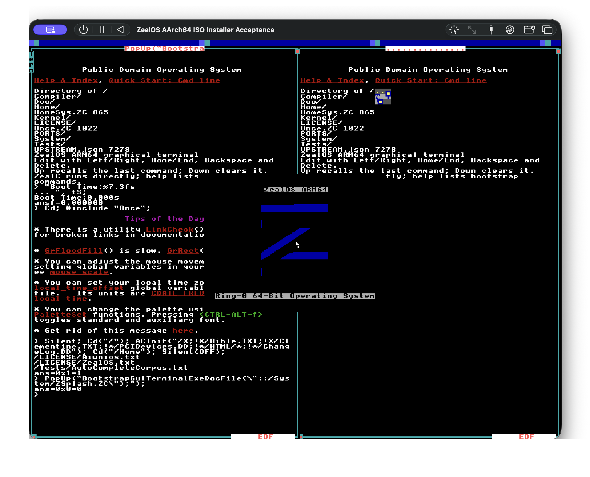

# ZealOS aarch64 bring-up

Limine → ZealBooter → kernel + `demo.hcbc` → HolyC-IR JIT → graphical terminal → **native USB or VirtIO input**

**Not a full ZealOS port.** QEMU/UTM has an accepted ARM64 ISO install,
disk-only desktop boot and saved-data persistence milestone. Physical Pi 4B
UEFI now boots the native graphical terminals with working USB keyboard,
pointer, menu clicks and `40+2;` returning `42`. Read-only USB storage remains
active alongside the desktop. The Pi desktop/basic input milestone is accepted;
writable Pi storage, persistence and installation remain work. See
[ACCEPTANCE.md](ACCEPTANCE.md) and [PI4.md](PI4.md).

## AArch64 desktop in UTM

The graphical desktop runs with two tiled terminals and the animated ZealOS
splash logo:



## Regular ZealOS programs

The **Apps** menu now launches unchanged upstream **Net of Dots**, **Lines**,
**Doodle**, **Mass Spring** and **Game of Life**. For the first two, you can also type
`#include "/Demo/Graphics/NetOfDots"` or `#include "/Demo/Graphics/Lines"`
in a graphical terminal. These are separate from the older adapted bring-up
commands. The complete pinned Apps/Demo collection (294 files) is bundled,
but most applications still need compatibility work. See
[PROGRAMS.md](PROGRAMS.md) for tested behavior and the remaining blockers.
`make check-stock-programs` and `make check-stock-interactive` exercise visible
drawing, mouse/keyboard input, animation and clean exit in QEMU with UTM's NEC
USB controller model. Live UTM checks also pass for Doodle drawing/colors,
Mass Spring motion/reset, Life evolution and all three programs' return to a
working terminal. Evidence is recorded in
[ACCEPTANCE.md](ACCEPTANCE.md).

## Native source compatibility milestone

A new **persistent compiler session** runs the pinned Aiwnios ARM64 compiler
inside the freestanding guest. The first integration target is the complete,
unchanged upstream `Kernel/QuickSort.ZC`, with separate callers exercising
recursion, callbacks, shared symbols, F64 and reclaimable allocations.

```sh
make check-compat       # disposable ISO guest + old boot regressions
make check-compat-pci   # disposable UTM-shaped GPT/PCI disk guest
make check-gui-terminal # terminal output ownership, menus, paint and zoom/pan
make check-gui-workflow # visible typing/cursors + graphical edit/save/run/reboot
make check-stock-programs # unchanged upstream graphics programs through Apps
make check-stock-interactive # Doodle, Mass Spring and Life with real input
make check-program-catalog # compile-only inventory of all Apps entry points
make check-iso-installer-usb # USB CD install, disk-only boot and persistence
make check-usb-input    # native NEC/QEMU xHCI keyboard, mouse/tablet + recovery
make check-usb-topology # nested USB2 hubs, repeated reconnects + subtree recovery
make check-pi4-platform # Pi FDT/DMA/xHCI, HID/storage and framebuffer adapter
make check-task-settings # upstream application state + task-local directories
make check-source-context # directory masks + relative document/project files
make check-source-execute # upstream ExeFile + native task-local file execution
make check-source-editor # full-screen editor scanout + save/reopen/run
make check-compiler-recovery # malformed source, statement rollback and task/stack recovery
make check-compiler-context # compiler queues, option inheritance and task isolation
make check-run-file     # task-local LastFun + upstream RunFile with application arguments
make check-source-exceptions # catchable source/file errors + prompt, job and task cleanup
make check-system-launch # upstream Sys/SysFile + popup application arguments
make check-system-server # dedicated source System loop + namespace/job ownership
make check-user-command # original ExeCmdLine loop, options and error recovery
make check-user-startup # per-user HomeSys setup and independent graphical terminals
make check-home-once    # original Once include, boot-media branch, tips and prompt recovery
make check-home-autostart # disk boot launches the saved Home/Once.ZC in the GUI terminal
make check-autocomplete # boot indexing and visible GUI fill-in on a disposable disk
make check-user-text    # User startup commands + XTalk input delivery and recovery
make check-home-path    # shared home paths, includes and saved source after reboot
make check-registry     # DolDoc execution, shared registry and Once across reboot
make check-input-edges  # visible modifier typing, held keys and explicit release
make utm               # refresh VM, preserving RedSea/source edits and adding new bundled files
```

The UTM refresh also updates the repository-managed
`Tests/WindowDragLive.ZC`, `System/GuiTerminal.ZC`, `System/TaskBridge.ZC`,
`System/UserTask.ZC`, `System/HomeStartUp.ZC`, `System/SourceDir.ZC`, `System/SourceHome.ZC`,
`System/VersionScalars.ZC`, `System/Registry.ZC`, `System/SourceRegistry.ZC`,
`System/SourcePrompt.ZC`, `System/SourceTraining.ZC`,
`System/DolDoc/DocCompiler.ZC`, `System/DolDoc/DocTree.ZC`,
`System/DolDoc/DocClipBoard.ZC`, `System/DolDoc/DocFile.ZC`,
`System/DolDoc/DocTerm.ZC`, `System/DolDoc/DocEd.ZC`, `System/WinMgr.ZC`,
`System/Gr/GrDC.ZC`, `System/Gr/SpriteRaster.ZC`, and
`Tests/GrSpriteSymmetry.ZC` files
so they stay in sync with the kernel; other existing guest source files remain
untouched.

The kernel now initializes native xHCI input on QEMU virt (UTM's NEC model
and QEMU xHCI). Keep UTM's normal USB 3.0 setting. A successfully enumerated
USB keyboard and pointer take ownership; VirtIO devices remain configured
as recovery input, with their transports parked while USB is active and
reinitialized on disconnect/failure. Terminal 1
serial input stays independent. `zstatus` reports the selected owners, raw
USB events, controller state, errors, and each device's route including USB2
transaction-translator slot/port; serial `usbcheck` exercises command and
event ring wraparound. This USB backend supports boot keyboards and single
HID mouse/tablet input reports, with or without a report-ID prefix, on root
ports or behind USB 1.x/2.0 hubs.
Port-change polling debounces new connections, removes hub subtrees, and
reuses reserved per-device DMA only after successful slot teardown. Limits
are eight devices, fifteen ports per hub and five hub tiers. A SuperSpeed hub
control path is present, but stock QEMU cannot exercise it and physical SS-hub
validation remains open. The QEMU hub stress gate uses generic full-speed hub
devices; physical high-speed TT routing is also pending. Pi's separate
PCIe/VL805 backend has physical keyboard, basic trackpad and read-only FAT32
USB-storage acceptance, including operation alongside its native desktop.
Writable Pi storage and disconnect/reconnect recovery remain work
([PI4.md](PI4.md)).

At the UTM prompt, run `zcheck`. Expected: `zc: upstream QuickSort + persistent
modules OK`. Use `zc` for declarations/statements, `zload` for a source file in the
boot archive, `zcall Function` (bare name, without parentheses or a semicolon)
for a no-argument integer function, and `zreset`
to discard the native session. Existing `hc`/`runzc` commands keep their original behavior.
`zput Name.ZC <source>` saves a short source file on the native 32 MiB source
partition in the 128 MiB UTM/GPT disk (legacy ISO/MMIO uses RedSea);
the `<source>` marker is explanatory syntax—do not type the angle brackets.
For example, `zput Tests/InstallerPersist.ZC I64 InstallerPersist(){return 40+2;}`
saves a callable persistence check.
`zload disk:Name.ZC` compiles it, including after a full reboot. The QEMU gates also
exercise a relative include between two disk files. `zverify` checks the
seeded large upstream files, and `scripts/source-volume.py put` can import a
larger file while the VM is stopped. For a running UTM guest, `zrecv` accepts
larger files as acknowledged serial hex chunks; `scripts/send-zc.py --emit`
produces lines to paste into Terminal 1. `zls` lists live source files and
`zrm <path>` hides one; `zgc` reclaims superseded records in the running guest
using the disk's second source bank. `zedit <path>` opens a guest line editor;
`j`/`k` move the selected line, `[`/`]` page through the file, and `g`/`G`
jump to its first or last line. It also supports `p`, `a`, `i`, `c`, `d`, `wq`
and `q!` commands, as well as numbered-line edits. Saved files load through
`zload disk:<path>`. The graphical editor reads absolute `/...` paths from the
writable source volume before falling back to bundled files, and saves those
absolute paths to the same persistent volume. `FilesFind` returns a merged
view of bundled files, native source files, and readable files in a legacy
RedSea root: saved replacements supply their native size, saved-only files
appear in listings, and tombstoned files are hidden. The legacy adapter lists
root files only and skips the `.` and `..` directory records.
Nested native-only paths also synthesize their parent directories in recursive
directory searches, and deleting the last native file removes those synthesized
directories from the merged view. Serial uploads refresh the same listing cache
as ordinary saves and deletes.
While `zedit` is active, the full-screen source view is composited over the
desktop every frame; enter its line-edit commands in UTM's built-in Terminal 1.
`make check-source-editor` checks visible controls and edits, modified/saved
state, disk reopen, and execution of the saved file.
The complete unchanged upstream
`KernelA.HH` and `KernelB.HH` load as declaration headers in that order.
The boot terminal's OS menu includes Window Demo, Lattice Play, and Stock Play.
Window Demo launches the two-window move/resize fixture; the two games launch
their interactive graphics demos. Each returns to the terminal when stopped
with Escape.
The unchanged `KMathB.ZC` also loads with ARM64 bindings for task-local `Fs`,
bit operations, the counter and a powers-of-ten table. A bounded cooperative
task bridge exposes the default upstream `Spawn` callback signature, `Yield`,
`TaskValidate`, `Suspend`, `IsSuspended`, `Kill`, `BirthWait`, `DeathWait`,
idle/prompt `TaskWait`, bounded `TaskMessage`/`MessagePost`/`MessageGet`
delivery, a per-task inherited-symbol `TaskExe`/`JobsHandler` subset with `MessageScan`
job dispatch, key-aware `MessageScan`/`MessageGet` and `KeyScan`/`KeyGet` over polled
USB/VirtIO/serial input, portable `CharScan`/`CharGet` behavior, and the pinned
`sys_focus_task` pointer for a focused child waiting on a key. It also exposes
CPU-0 `JobQueue` callbacks and `SpawnQueue` task creation. A reserved executive runs queued jobs; four
live app child tasks still have their own stacks and allocation owners.
Desktop boot also starts a separate System task in a reserved slot. Its
`ServerTaskCont` control flow comes from pinned `KTask.ZC`, with job execution
routed through the native compiler/unwind dispatcher. `Sys` and `SysFile`
execute there; the serial shell retains its own root stack and input. System
shares the persistent kernel namespace, has its own guest heap, directory,
queues and compiler-context stack, and drains UI messages as upstream does.
The graphical terminal now runs the original `UserCmdLine`, `UserTaskCont` and
`ExeCmdLine` control flow through a private ARM64 compiler ABI. Type ZealC
directly, for example `40+2;`. `User;` creates another terminal with its own
document, compiler context and history. The default per-user hook retains the
pinned `HomeSys.ZC` welcome-document/window setup, then installs the accepted
graphical input adapter. `User("40+2;\n")` supplies an initial command;
`XTalk` and `XTalkWait` send further input to that terminal's compiler through
the source KeyDev input filter. `ExeDoc` now reads real DolDoc entries through
the native lexer, including quoted formatting, macros and includes. The original
registry tree APIs share a System-owned cache backed by `~/Registry.ZC`.
`Once`, `SysOnce` and explicit `OnceExe` execute and flush saved User/System
branches. On disk, RAM, and DVD boots, the first graphical terminal now
receives the original `Cd; #include "Once";` startup command through `XTalk`.
Boot run-level flags now record the dedicated System task, persistent Registry,
and Home startup only after each phase succeeds; the reboot checks wait for
the graphical terminal to consume its queued `Once` command before asserting
the persisted values and flushes.
DVD boot opens the live graphical session. Its bounded UTM/QEMU installer
accepts one 128 MiB PCI VirtIO target disk and requires the explicit
`zinstall ERASE` confirmation; it writes the packaged GPT/ESP/source image and
reads back every sector. It is separate from the legacy YDE installer, whose
BIOS/AHCI storage path is not ported. Disk/RAM startup also opens a second
terminal and tiles it beside the first, excluding bridge/System tasks from the
window layout. Startup queues autocomplete indexing after `Once`; the
autocomplete corpus is indexed by its background task, and the first prompt is
checked for a visible caret and usable input after startup output. The bundled
ARM64 `ZSplash.ZC` adapter restores the pinned CP437 mesh asset, runs the
upstream rotating splash with the native pointer enabled, and restores terminal
focus when dismissed. Automated scanout checks cover the two-terminal boot,
splash animation and dismissal, popup windows, terminal input and autocomplete
fill-in.
The OS menu's Paint Demo keeps a small retained stroke while the left pointer
button is held, draws a yellow line as the pointer moves, and clears it on
Escape. QEMU checks exercise pointer sampling, gap interpolation, and actual
screen-CDC raster output. A live UTM screenshot now confirms yellow strokes
drawn over the graphical terminal; Paint Demo is an inline mode, not a separate
window. The Escape reset path clears retained strokes and the partial command;
`make check-home-autostart` exercises the reset and next empty paint frame. The
final-image UTM guest passed the automated Escape test; the saved UTM screenshot
shows Paint Demo drawing but does not capture the Escape gesture itself.
The original `Cd; #include "Once";` path now runs with the compiler's `.ZC`
default extension, source-backed `YorN` and `TipOfDay`, and the original tips and
customization documents. `sys_boot_src` comes from the actual Limine module
medium: disk, optical, or TFTP download. The splash asset is restored from its
UTF-8 CP437 source bytes, and the renderer normalizes the 0x100 transform flag
before using its 8-bit Boolean state. The DVD live path is covered by
`make check-dvd-live`; disk/RAM HomeSys startup preserves its formatted boot-time
banner, two-terminal layout, splash and popup flow. `make check-home-once` also
covers the disk and ISO/DVD noninstall branches, including include/tip/error
cleanup. The ARM64 compiler preserves superscript, subscript and normal-script
DolDoc markers inside identifiers and executes inline binary DolDoc tokens,
including payloads with embedded NUL bytes. Startup uses a guarded translation
of the pinned `HomeSys.StartUpTasks` body. `make check-iso-installer` covers the
bounded ISO installer on a disposable VirtIO disk, including byte-for-byte
image verification, disk boot, and saved source persistence across reboot; it
does not port the original YDE BIOS/AHCI installer. `zstatus`
also reports `keyboard_state` modifier and repeat values to diagnose held host
keys separately from guest decoding.
The bridge also maintains the upstream-visible runnable-task and parent/child
task rings, including `TaskFocusNext` selection and child unlink on teardown.
`TaskMathChecks`,
`TaskSwitchChecks`, `SpawnBridgeChecks`, `TaskLifecycleChecks` and
`TaskWaitChecks`, `TaskIdleChecks`, `TaskMessageChecks`, `TaskExeChecks` and
`TaskExeLifecycleChecks`, `TaskExeFocusChecks`, `TaskMessageJobsChecks`, `TaskKeyChecks`,
`TaskCharQueueChecks`, `KernelBitOpsChecks`, `TaskIRQFlagsChecks`, `TaskQueueChecks`,
`TaskFocusKillChecks`, `TaskCompilerScopeChecks`, `TaskAnswerChecks`, `TaskJobQueueChecks` and
`TaskSpawnQueueChecks` exercise
those paths. Most other x86 intrinsics and unresolved externals
remain unavailable. This does not boot the upstream kernel or provide its
preemptive scheduler.

The current ISO, `build/zealos-aarch64-hello.iso`, has SHA-256
`52c214c29a9c23d86c94899e8ef2ba94bd4a21231c92ecdd649714708e2bc627`.
`make check-iso-installer` passed against this exact build: guarded erase,
full 128 MiB read-back, disk-only desktop boot, and saved-data persistence
(`InstallerPersist` returned `0x2a` before and after a second cold reboot).
The embedded installer disk `build/disk.img` has SHA-256
`1a4516a67d42aecc7284bfc68e455c5231767360e75a9df021dddb6946d98fde`.
The exact current ISO (`52c214c…`) was installed in UTM to a disposable 128 MiB
VirtIO disk and passed full sector read-back. A separate disk-only UTM VM
cold-booted to the desktop; its captured screen shows both terminals and the
centered animated Z. `InstallerPersist` returned `0x2a` before and after a
second cold reboot. The live guest also returned `0x2a` for Ctrl-Alt-F font
dispatch, while the menu, paint Escape cleanup, and startup graphics checks
passed in the automated guest gates. See [ACCEPTANCE.md](ACCEPTANCE.md).

[COMPATIBILITY.md](COMPATIBILITY.md) describes the scope and remaining work.
This does not boot the original upstream kernel and remains a scoped ARM64
desktop/runtime port. It includes a bounded UTM/QEMU ISO installer for its
128 MiB VirtIO disk image. Pi diagnostics remain a separate path.

## Status

```
virtio-kbd: OK @ 0xa003e00
virtio-tablet: OK @ 0xa003c00
hc IR OK (front+host)
bc: module => 0x2d OK
> bars
bars ok
> stars
stars n=0x78
> circles
circles ok
> bounce
bounce frames=0x24
> paint
paint dots=0x0
```

| Piece | Result |
|--|--|
| Boot + GIC/CNTP + module JIT | OK |
| HolyC (`enum`/`union`, `I64*`/`U8*`, `U32`/`Bool`, `true`/`NULL`, ≤8 fns/≤5 args) | OK |
| Host: strings/`Mem*`/`HashStr`, math, `Cnt`, mouse deltas, keys, gfx | OK |
| Fast `Cls`/`FillRect` + `GrLine`/`GrHLine`/`GrVLine`/`GrCircle`/`GrFillCircle` | OK |
| Shell `bars` / `stars` / `circles` / `bounce` / `paint` | OK |
| virtio keyboard + tablet | OK (QEMU/UTM) |
| native USB keyboard + mouse/tablet | NEC and QEMU xHCI matrices pass USB-only, VirtIO fallback, nested hubs/hotplug; live UTM typing and released-pointer drag accepted |
| RedSea + freeze `runzc` UseAdd/Notes/MemSort | OK (`make check-serial` / `run-pci`; UTM eyes-on in ACCEPTANCE.md) |
| Lattice compose (`disklat` / `latticeplay`) | NEC/xHCI live-control regression green (`make check-lattice-controls`); UTM placement/aim, color/Return restart, Space/Escape, and zoom confirmed |

Window keystrokes (`make run-iso`) and serial both feed the shell. HHDM lacks the virtio-mmio window, so the kernel maps a 2MiB Device block at `0x0a000000` before probing.

`make check-serial` uses QEMU virt + MMIO virtio disk. It does **not** exercise the UTM app window or Pi UART RX. Lattice smokes run a reduced DiskLat-shaped source ([upstream/DiskLat.ZC](upstream/DiskLat.ZC)), not proof that stock ZealOS `Demo/Graphics/Lattice.ZC` runs unchanged.

## Shell

```
help | abs | sum | bars | stars | circles | bounce | paint | halt
hc GrCircle(200,150,40,0xFFFFFF);return 1;
hc I64 x=3;I64 *p=&x;*p=9;return x+(NULL==0);
disklat | latticeplay   # Lattice compose; Esc exits live play
```

## Build

```sh
make && make run-serial
make run-iso   # bars / stars / circles / bounce / paint / click / Esc
make check-serial   # QEMU regression (must print hc IR OK)
```

UTM: `make utm` → only **ZealosAarch64Hello** ([ACCEPTANCE.md](ACCEPTANCE.md)).

Pi 4B UEFI (parallel track): [PI4.md](PI4.md). `make pi-desktop-sd` prepares
`build/pi-desktop-esp/` with the native desktop, bundled sources and the accepted
USB diagnostic recovery entry; `make pi-sd` prepares diagnostics only. These
targets prepare files without writing a card. Existing Pi UEFI/firmware/DTBs
must be preserved; a fresh card first needs [pftf/RPi4](https://github.com/pftf/RPi4/releases).

Bridge notes: [AIWNIOS.md](AIWNIOS.md). Milestone ladder: [upstream/README.md](upstream/README.md).

## Tracks

| Track | Status |
|--|--|
| QEMU/UTM virt | Live ISO install/disk-only desktop/persistence accepted for `52c214c…`. Current program ISO `build/zealos-aarch64-hello.iso` (`3b59782c…`) adds unchanged Net of Dots, Lines, Doodle, Mass Spring and Life in Apps. NEC/VirtIO program interaction, full graphics/editor workflow, USB-CD installation and disk-only persistence gates pass. Doodle, Mass Spring and Life also pass live UTM drawing/input, animation, reset where applicable, and terminal recovery. See [ACCEPTANCE.md](ACCEPTANCE.md) and [PROGRAMS.md](PROGRAMS.md). |
| Pi 4B UEFI | **PI-DESKTOP-2 native desktop/basic input accepted (2026-10-26)**: native graphical terminals, visible pointer movement, menu clicks and `40+2; → 42`. IMG_9182 confirms firmware 1920×1280, packed 800×600 desktop scaled 2×, 1632 composed frames and USB active/fault/stopped 1/0/0. Physical read-only FAT32 USB file reads and simultaneous keyboard/pointer/storage were accepted earlier. Kernel `b12497c8…93d4930b`; M6 diagnostic recovery preserved. Writable persistence, native SD, reconnect recovery and Pi installation remain open ([PI4.md](PI4.md)). |

## Earlier platform follow-ups

1. UTM: continue the remaining application compatibility work listed in PROGRAMS.md. Doodle, Mass Spring and Life pass live checks in `3b59782c…`; automated program, graphics, editor and ISO install/persistence gates also pass. Preserve the accepted images while developing the next additions.
2. Pi: extend the accepted native desktop/input milestone to source-program/editor workflows and writable save/reboot/reopen persistence; native SD, disconnect recovery and installation remain open.
3. HCRT host stubs only after IR gap shrinks; DT-based discovery before other ARM64 boards
